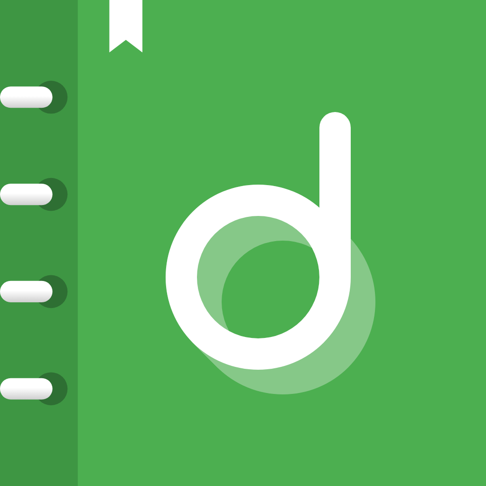

<p align="center">
  
</p>

<h1 align="center">Dayloom</h1>

<p align="center">
  A private, offline journal and to-do list for phone, tablet, desktop and web, built with Flutter.
</p>

<p align="center">
  
  
  
  
</p>

---

Dayloom puts a daily journal and a task list in one app. It has no account, no server and no tracking. Everything is saved on the device as you type. The same codebase adapts its layout to the screen: a bottom tab bar on phones, an icon rail on tablets, and a collapsible sidebar with a side-by-side list and editor on wide windows.

<!--
  Screenshots: add images to docs/screenshots/ and uncomment.
  <p align="center">
    
    
  </p>
-->

## Features

### Journal
- Dated entries with a title, body, mood (five-point scale) and a gratitude line.
- Back-date an entry to log a day after the fact.
- Tags, plus inline `#hashtags` picked up from the text. The parser skips false matches like `C#`, `#1` or `/page#top`.
- Search, and filter by mood or tag.
- Overview card with writing streak, entry and word counts, and a 7-day mood strip.
- Rotating writing prompts as the placeholder text.
- Autosave. Existing entries save a moment after you stop typing. A new entry is kept as a draft until you save it, so unfinished work survives a reload without cluttering the journal.

### To-dos
- Quick-add from anywhere, then add notes, a due date and a priority.
- **Detailed mode**: progress ring, Overdue / Today / Upcoming smart lists, sorting and filtering.
- **Simple mode**: a plain checklist for people who just want to tick things off.
- Clear completed tasks, with Undo for deletes and clears.

### Across the app
- Light and dark themes with an animated switch.
- Responsive layout with three breakpoints (compact < 640 px, medium < 1100 px, expanded ≥ 1100 px).
- Floating glass tab bar on phones in portrait.
- In-app About page that explains where data lives and how it is protected.
- Custom app icon and splash screen on every platform.

## Privacy by design

| | |
|---|---|
| **Storage** | Local only, as JSON via `shared_preferences` (browser `localStorage` on web). |
| **Network** | None. The app makes no requests. Android and macOS release builds don't request internet permission. |
| **Tracking** | No analytics, ads or crash reporting. |
| **Backups** | Android cloud backup and device transfer are turned off. |
| **Trade-off** | No sync between devices, and uninstalling the app deletes the data. |

## Architecture

Dayloom follows the layered MVVM structure recommended in the [Flutter architecture guide](https://docs.flutter.dev/app-architecture).

```
Views (widgets)
   │  watch / call
ViewModels (ChangeNotifier)          ← one per feature, created above the router
   │  read / write
Repositories                         ← single source of truth, in-memory + change stream
   │
LocalStorageService                  ← thin JSON wrapper over SharedPreferencesAsync
```

- **Dependency injection** with `provider`. `main.dart` wires the service and repositories. `app.dart` creates the view models above the router, so state survives tab switches.
- **Optimistic updates.** Repositories update memory first so the UI responds at once, then write through to storage and announce the change on a broadcast stream.
- **Immutable models** (`JournalEntry`, `Todo`) with `copyWith`. Nullable fields take a closure so a caller can clear them on purpose.
- **Routing** with `go_router`. A `StatefulShellRoute` gives each tab its own navigation stack. All journal routes share one page key, so on wide screens the list and editor stay on screen together and the list keeps its scroll position and search text.
- **Design tokens** for spacing, radii, breakpoints and motion (`lib/core/theme/tokens.dart`) instead of hard-coded numbers.
- **Swappable storage.** `LocalStorageService` is the only class that touches persistence, so it can be replaced with a REST or Firebase backend without changing repositories or view models.

### Project layout

```
lib/
├── main.dart                 # dependency graph
├── app.dart                  # MaterialApp, themes, view models
├── core/
│   ├── router/               # go_router configuration
│   └── theme/                # colours, theme data, design tokens
├── data/
│   ├── models/               # JournalEntry, Todo, Mood, Priority, ...
│   ├── repositories/         # journal, todo, settings
│   └── services/             # LocalStorageService
└── ui/
    ├── shell/                # sidebar, icon rail, glass tab bar
    ├── journal/              # workspace, editor, view models, widgets
    ├── todos/                # list, editor sheet, view models, widgets
    ├── settings/             # theme and sidebar preferences
    ├── about/                # About page
    └── core/widgets/         # shared widgets
tool/
├── branding/                 # generates icon and splash art from code
└── serve_web.js              # zero-dependency server for the web build
```

## Tech stack

| Area | Choice |
|---|---|
| Framework | Flutter (Material 3), Dart 3 |
| State management | `provider` + `ChangeNotifier` |
| Navigation | `go_router` |
| Persistence | `shared_preferences` |
| Utilities | `uuid`, `intl` |
| Branding | `flutter_launcher_icons`, `flutter_native_splash` |
| Typography | Inter, bundled so text renders the same offline and in tests |
| Quality | `flutter_lints`, widget tests |

## Getting started

**Requirements:** the Flutter SDK (stable channel, Dart ≥ 3.13) and the toolchain for each platform you want to build.

```bash
git clone https://github.com/gint-collab/Dayloom.git
cd Dayloom
flutter pub get
flutter run                 # pick a device, or add -d chrome / -d windows / ...
```

### Run the checks

```bash
flutter analyze
flutter test
```

### Build and share the web version

```bash
flutter build web
node tool/serve_web.js      # http://localhost:8080 (pass a port to change it)
```

Every push to `main` deploys the web build to [dayloom-int.vercel.app](https://dayloom-int.vercel.app) through [`.github/workflows/web.yml`](.github/workflows/web.yml). It needs a `VERCEL_TOKEN` repository secret, which you create at [vercel.com/account/tokens](https://vercel.com/account/tokens).

### Release builds

Pushing a tag like `v1.2.0` runs [`.github/workflows/release.yml`](.github/workflows/release.yml). It runs the checks, builds a signed APK and App Bundle, and publishes them as a GitHub Release. You can also run it by hand from the Actions tab. A manual run only uploads the files as a workflow artifact.

```bash
git tag v1.0.0
git push origin v1.0.0
```

Signing reads `android/key.properties`, which is gitignored. CI writes that file from four repository secrets: `ANDROID_KEYSTORE_BASE64`, `ANDROID_KEYSTORE_PASSWORD`, `ANDROID_KEY_ALIAS` and `ANDROID_KEY_PASSWORD`. To sign locally, create the file yourself:

```properties
storeFile=/absolute/path/to/upload-keystore.jks
storePassword=...
keyAlias=upload
keyPassword=...
```

If the file is missing, release builds fall back to the debug key, so `flutter run --release` still works on a fresh clone.

### Regenerate the icon and splash screen

The source art is drawn in code by `tool/branding/generate_branding_test.dart`, based on the references in `design/reference/`.

```bash
flutter test tool/branding/generate_branding_test.dart
dart run flutter_launcher_icons
dart run flutter_native_splash:create
```

## Possible next steps

- Export and import (JSON or Markdown) for backup and moving between devices.
- Optional passcode or biometric lock.
- Encrypted on-device storage.
- Reminders for due tasks.
